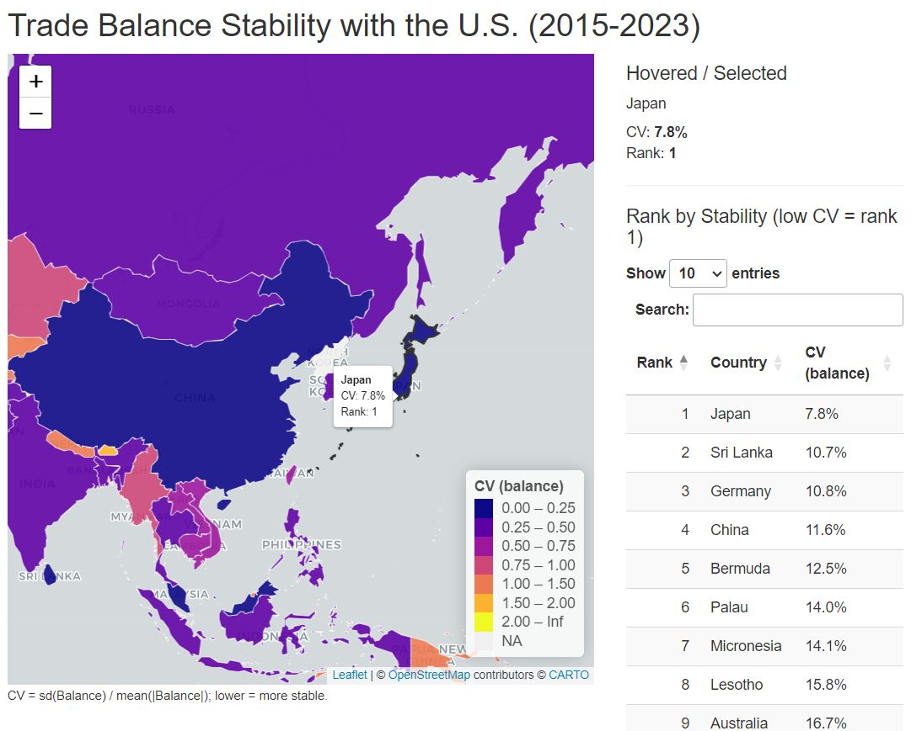
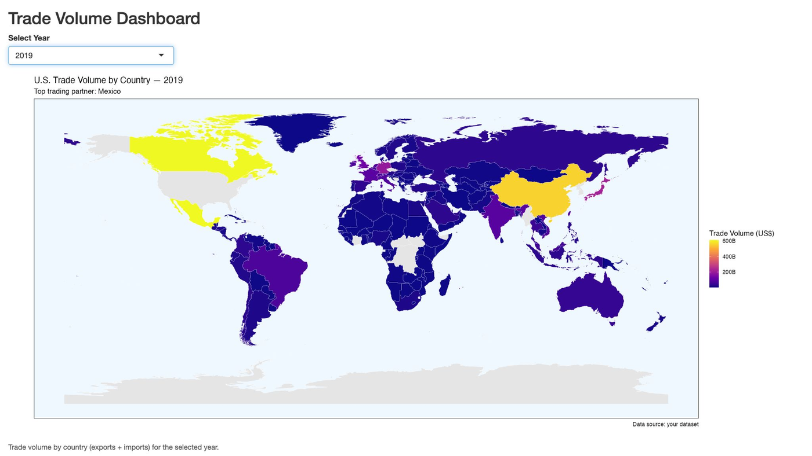
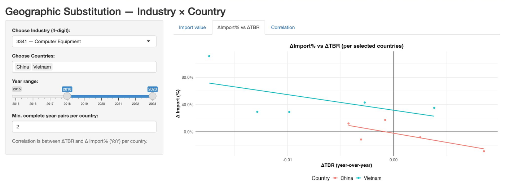
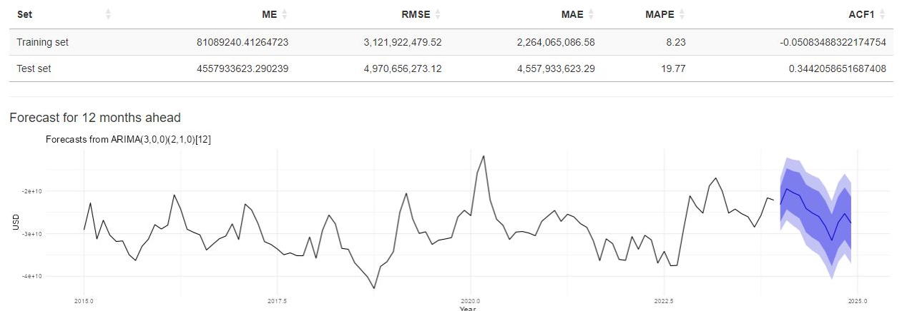

# U.S. Trade & Tariff Analysis (2015–2023)


How did U.S. tariff policy after 2017 change who America trades with? Our team analyzed U.S. trade data by country and industry, built interactive R Shiny dashboards, and forecast future trade balances.



*Interactive map ranking every U.S. trade partner by trade-balance stability. Japan ranks #1.*

## Key findings

| | Finding | Evidence |
|---|---|---|
| 1 | **Tariffs hit China and Mexico differently** | Regression: tariff pressure significantly affected Mexico's trade volume (p < 0.05), but not China's |
| 2 | **Japan is the most stable U.S. trade partner** | Lowest trade-balance volatility: Japan 7.8%, Germany 10.8%, China 11.6% (coefficient of variation) |
| 3 | **Vietnam replaced China in computer equipment** | After 2018, U.S. computer equipment imports from China fell while imports from Vietnam rose sharply |
| 4 | **Forecasts got harder after the tariffs** | ARIMA error rose from 8.2% (training) to 19.8% (test) as trade became more volatile |

### Who does the U.S. trade with?
China was the top U.S. trading partner through 2018. From 2019, Mexico and Canada took turns at #1.



### Supply chains moved from China to Vietnam
Each point is one year. After 2018, as tariff pressure on China rose, its import growth fell, while Vietnam's kept rising.



### Forecasting the trade balance
Pick any country and the app fits a seasonal ARIMA model, tests it on the last 12 months, and forecasts the next 12 months with 95% confidence bands.



## My role

I built two of the team's interactive dashboards:

- **Trade balance stability map** ([`code/Question4.Rmd`](code/Question4.Rmd)): calculates each country's coefficient of variation of trade balance, ranks 229 countries, and maps them with Leaflet, with hover details and a searchable ranking table.
- **Trade balance forecasting app** ([`code/Predictive Model.Rmd`](code/Predictive%20Model.Rmd)): seasonal ARIMA per country with a train/test split, accuracy metrics (RMSE, MAE, MAPE), and a 12-month forecast.

## What I learned

The forecasting model fit the historical data well (8.2% error) but was much less accurate on recent months (19.8%). Tariff changes created shifts that past patterns couldn't predict. Next time I would add tariff and policy variables to the model instead of relying on trade history alone.

## Methods

| Question | Method |
|---|---|
| What drives trade volume? | Multiple regression, hypothesis testing at the 5% level |
| Which partners are most stable? | Coefficient of variation, ranking |
| Did tariffs shift supply chains? | Correlation of Δ trade balance ratio vs. Δ import growth |
| What happens next? | Seasonal ARIMA with train/test validation |

## Repository structure

```
code/      R Markdown files for each analysis and dashboard
data/      Small derived datasets (see data/README.md)
images/    Dashboard screenshots
reports/   Executive summary and presentation (PDF)
```

## How to run

1. Install [R](https://cran.r-project.org/) and [RStudio](https://posit.co/download/rstudio-desktop/).
2. Install packages:
   ```r
   install.packages(c("shiny", "tidyverse", "lubridate", "forecast", "DT", "zoo",
                      "leaflet", "sf", "countrycode", "rnaturalearth",
                      "rnaturalearthdata", "viridisLite", "scales"))
   ```
3. Put the data file in the same folder as the `.Rmd` file, open it in RStudio, and click **Run Document**.

## Data

U.S. export and import values by country and commodity, 2015–2023, provided for the UW–Madison Data Challenge. The full cleaned dataset (~120 MB) is over GitHub's file size limit, so it isn't included.

## Team

**MADANNI**: Naqib Nazri, Aimin Najwa, Sofea Hafizi, Izhan Shamsuri

## Tools

R · Shiny · Leaflet · tidyverse · forecast (ARIMA) · sf · ggplot2
